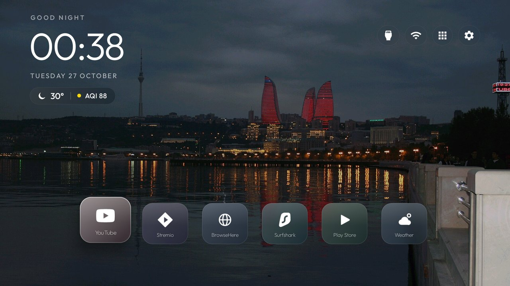
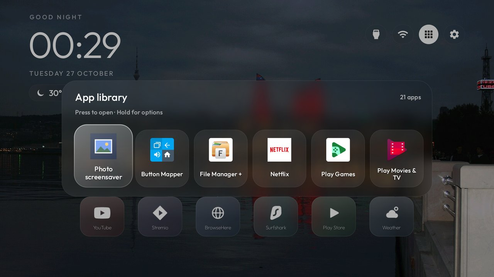

# TCL Google TV, glass style

Debloat a **TCL Google TV** and give it a calm, Apple-TV-inspired home screen: frosted-glass cards, rotating photo wallpapers, the weather and
air quality in a small pill, a compact app library and a photo screensaver. Everything is **reversible**: nothing is uninstalled, and one
script puts it all back.

| Home | App library |
|---|---|
|  |  |

> **Unofficial and at your own risk.** This is a hobby project, not affiliated with or endorsed by TCL, Google, Apple or anyone
> whose logos appear on the tiles. It was built and tested on **one** TV (see [Does it work on my TV?](#does-it-work-on-my-tv)). Disabling
> system packages can misbehave on firmware nobody has tried it on. Read the safety section before you touch your TV.

## What you get

- **A debloated TV.** Seven small batches that switch off TCL's telemetry, ad and promo services, preloaded apps and a few apps most people never
  open, with a comment on every package. Live TV, HDMI inputs, the remote, Bluetooth pairing, the keyboard and Google Play are left alone.
- **A glass-style launcher.** One centred row of square frosted-glass cards. The wallpaper is blurred once when it loads, and each card, pill and
  button shows the blurred slice behind it, so logos and names stay sharp. The focused card rises by itself; there is no sliding overlay and no thick border.
- **Wallpapers that change.** A shuffled collection of travel photos, a new one every 5 minutes while Home is on screen. Bring your own.
- **Weather and air quality** for your city under the clock, e.g. `30° │ AQI 88`. The launcher itself still has **no internet access**: a separate 11 KB
  app fetches the data from [Open-Meteo](https://open-meteo.com/) and hands it over locally. Optionally use your own [IQAir](https://www.iqair.com/) key
  for a station reading.
- **A compact app library** in the same glass, so Home stays one clean row while every other app is one press away.
- **A photo screensaver** with a clock, started by the TV's idle timer or simply by pressing **Back on Home**.
- **Your remote's app buttons** mapped to the apps you actually use.
- **Scripts for all of it**, including a restore that undoes every step.

It is built on the open-source [**Clean Your TV**](https://github.com/Gathin23/cleanyourtv) project (MIT). This repository holds only what was added or
changed on top of it, pinned to the exact upstream commit it was made against, and `bootstrap.sh` puts the two together for you.

## Does it work on my TV?

- **Tested on:** TCL "Smart TV Pro", board G05, product `G05_4K_GB`, Google TV on Android 11, firmware AR2101 / AR25. Nothing else.
- **The debloat lists are for that TV.** Other TCL sets share many package names, but firmware differs in what it re-enables at boot and in how the setup
  wizard behaves. Treat the lists as a starting point: read each package with `dumpsys package <name>` before you disable it. The upstream project has
  tested lists for many other models in its `examples/` folder.
- **The launcher** needs Android 8.0+ (SDK 26) and a TV that accepts sideloaded APKs. Some China-market sets refuse them, and some firmware refuses any
  launcher that is not the maker's own. In that case you can still do the debloat half.
- **Not for** Samsung (Tizen), LG (webOS), Roku or other non-Android TVs: there is nothing to run on them. See the upstream project for what you can do instead.

## What you need

- A Mac or Linux computer on the same network as the TV, with `git`, Python 3, **JDK 17** and the **Android SDK** (platform 34, build-tools 34.0.0; the
  command-line tools are enough). Set `ANDROID_HOME`, or put the SDK in `./android-sdk`.
- On the TV: Developer options on (Settings > System > About, press the build entry seven times), **USB debugging** on, and the TV's IP address.

## Quick start

```bash
git clone https://github.com/isabirahmed/tcl-google-tv-glass-setup
cd tcl-google-tv-glass-setup
./bootstrap.sh                  # clones Clean Your TV at the pinned commit, applies the patch, installs the lists
export TV_HOST=192.168.1.50     # your TV's address
cd tcl-tv-kit
```

Then, in order (each step is explained, with the things to check, in [`docs/setup-guide.md`](docs/setup-guide.md)):

1. **Back up first** and read the guide's safety notes.
2. **Edit what is personal to you** (see [Make it yours](#make-it-yours)): the apps in the row, the remote buttons, your city.
3. `./apply-debloat.sh 1 2 3 4`: debloat, with a screenshot between batches.
4. Handle the **setup wizard** (batch 5): on Google TV it can own your saved Wi-Fi network, and disabling it would take the TV off Wi-Fi.
5. `./install-launcher.sh`: builds, installs, makes it Home, and only then disables the stock launcher.
6. `./install-weather-feed.sh`, then push the wallpapers with `cleanyourtv/tools/theme.sh theme`.
7. Install the photo screensaver and sync your pictures (steps in the guide).
8. Reboot once and check everything came back.
9. **Close ADB when you are done**: it is plaintext on your network.

**Undo everything:** `./restore.sh` (re-enables every package, gives Home back to the stock launcher, restores the Google screensaver and Private DNS).

## Make it yours

All of it lives in `cleanyourtv/launcher/app/src/main/res/values/config.xml` after bootstrap; re-run `./install-launcher.sh` to apply.

| To change | Key or file |
|---|---|
| The apps in the row, and their order | `dock_apps` (package names: `tools/tv.py 'pm list packages'`) |
| Apps kept off Home (they stay in the App library) | `hidden_apps` |
| Card size, row length | `square_tile_dp`, `square_tile_aspect`, `columns` |
| What the remote's coloured buttons open | `app_keys` (`keycode:package`). The codes in the file are one TCL remote's; find yours by pressing a button and reading `key = <code>` from `logcat -s TclPhoneWindowManager:V` |
| Back on Home starts the screensaver | `back_starts_screensaver` |
| Your city for the weather | `tcl-tv-kit/weather-feed/app/src/main/res/values/strings.xml` |
| Wallpapers and how often they change | `tcl-tv-kit/theme/` (`wallpapers/` and `config.json`: `wallpaper_rotation_minutes`, `wallpaper_dim`) |
| A tile's logo | add an SVG to `tcl-tv-kit/icons/custom/`, list it in `icons/build_icons.py`, run it, and register it in `app_banners` |

**Air quality, model or station?** By default the pill shows Open-Meteo's air-quality *model* (a 24-hour average on a coarse grid), which can read well
above ground stations. For a station reading, get a free IQAir API key and run `./set-aqi-key.sh` yourself: it asks for the key with the input hidden and
stores it only inside the feed app. The scripts never write it to a file, and the launcher never receives it (it is visible in the process list for a moment, so use a machine only you use).

## How it works

The short version: a **patch** to the Clean Your TV launcher (new look, local-only weather reader), a **headless feed app** that is the only part with internet access,
the **debloat lists**, a **theme** of wallpapers, and the **scripts** that tie them together. The longer version, including what each file does and the security
model, is in [`docs/how-it-works.md`](docs/how-it-works.md). Problems and quirks (the setup wizard, the remote-key helper, TCL's background-start rules) are in
[`docs/troubleshooting.md`](docs/troubleshooting.md).

## Safety, privacy and undo

- **Disable, never uninstall.** `pm disable-user --user 0`, one package at a time, in small batches. The scripts refuse a list that contains Android's core packages.
- **Everything is recorded.** The scripts write what each package's state was before the change, and `restore.sh` replays it.
- **The launcher stays offline.** Its manifest has no `INTERNET` permission. The feed app has it, exposes one read-only row, and its key setter only answers the ADB shell.
- **No secrets in this repository.** There are no keys, passwords, Wi-Fi names, addresses or device identifiers, and you should keep it that way if you fork it.
- **Close ADB afterwards:** turn USB debugging off, revoke the authorisations, reboot, and check the port with `cleanyourtv/tools/adb-closed.py <tv ip>`.

## Using an AI coding agent?

[`PROMPT-for-your-agent.md`](PROMPT-for-your-agent.md) is a prompt that has an agent such as Claude Code do these steps with you, with the safety rules built in.

## Credits and licences

- **Code, patch, scripts and docs in this repository: MIT**, see [`LICENSE`](LICENSE).
- **[Clean Your TV](https://github.com/Gathin23/cleanyourtv)** by Gathin (MIT) is the base of the launcher and its tools; its licence is in [`licenses/`](licenses/).
- **Wallpaper photos** are from Wikimedia Commons under CC BY / CC BY-SA and keep those licences, not the MIT one. Credits for every picture are in
  [`tcl-tv-kit/theme/CREDITS.txt`](tcl-tv-kit/theme/CREDITS.txt).
- **Weather and air-quality data by [Open-Meteo.com](https://open-meteo.com/)** (CC BY 4.0).
- Logos are drawn from [Simple Icons](https://simpleicons.org/) (CC0) or are simple originals; the brands they depict belong to their owners.
- Everything else, with details: [`NOTICE.md`](NOTICE.md).

Issues and pull requests are welcome, especially debloat lists and notes for other TV models. Please never include your own IP address, Wi-Fi name, serial number or keys.
